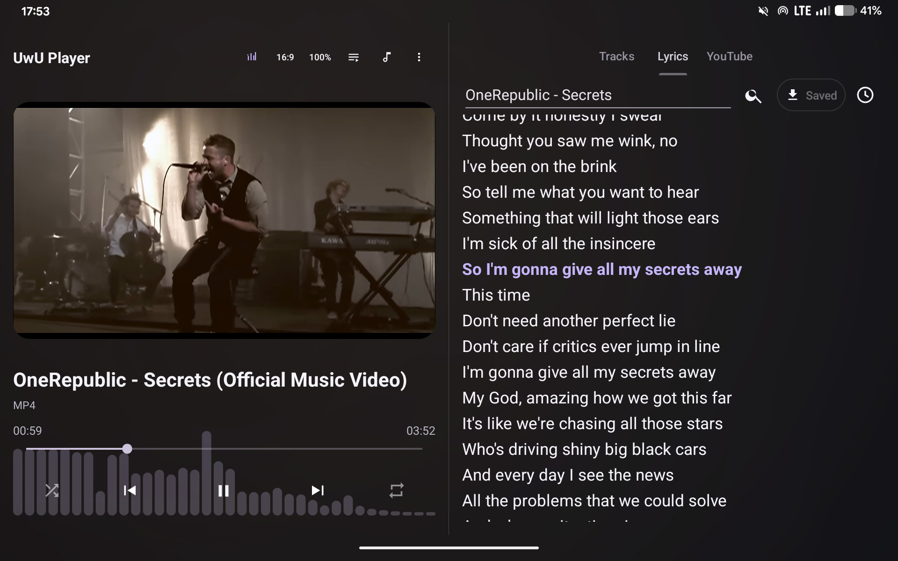
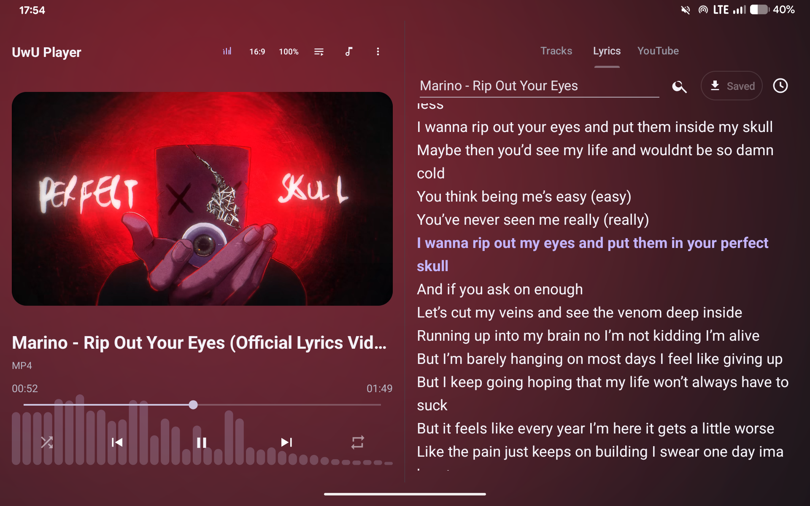

<div align="center">

# Waguri MPV


</div>

**MPV Music Player**

A personal-use project (vibe coding).




## Features

- GUI redesigned to look like a music player.
- Offline file playback.
- YouTube downloads directly through the server.

## Server Setup

For server setup, refer to the following repository:

https://github.com/DirmdsLab/yt-dlp-script

**Port:** `7010`

## App Compilation

Clone the repository:

```bash
git clone https://github.com/DirmdsLab/waguri-mpv.git
```

```bash
cd waguri-mpv
```


### Build Environment

Keep your host OS clean by using a Podman container:

```bash
podman run -dit \
    --name waguri-mpv \
    -v "$(pwd):/workspace/waguri-mpv:Z" \
    -w /workspace/waguri-mpv \
    docker.io/library/ubuntu:24.04 \
    bash
```

Update the package list and installed packages:

```bash
apt update && apt upgrade -y
```

Install the required packages:

```bash
apt install sudo git default-jdk-headless -y
```

### Meson Version

Check the installed Meson version:

```bash
meson --version
```

The required version is **1.11.0 or newer**.

If the installed version is outdated, upgrade Meson:

```bash
apt remove meson -y
apt install python3-pip -y
pip3 install --break-system-packages --upgrade meson
```

Verify the installed version:

```bash
meson --version
```

Make sure the result is `1.11.0` or newer.

### Build

Navigate to the `buildscripts` directory:

```bash
cd buildscripts
```

Download the required dependencies:

```bash
./download.sh
```

Build the application:

```bash
./buildall.sh
```

## Build Output

After a successful build, the APK files will be available at the following paths:

### All Storage

**Debug:**

```text
../app/build/outputs/apk/allstorage/debug/app-allstorage-arm64-v8a-debug.apk
../app/build/outputs/apk/allstorage/debug/app-allstorage-armeabi-v7a-debug.apk
../app/build/outputs/apk/allstorage/debug/app-allstorage-universal-debug.apk
```

**Release:**

```text
../app/build/outputs/apk/allstorage/release/app-allstorage-arm64-v8a-release-unsigned.apk
../app/build/outputs/apk/allstorage/release/app-allstorage-armeabi-v7a-release-unsigned.apk
../app/build/outputs/apk/allstorage/release/app-allstorage-universal-release-unsigned.apk
```

### Default

**Debug:**

```text
../app/build/outputs/apk/default/debug/app-default-arm64-v8a-debug.apk
../app/build/outputs/apk/default/debug/app-default-armeabi-v7a-debug.apk
../app/build/outputs/apk/default/debug/app-default-universal-debug.apk
```

**Release:**

```text
../app/build/outputs/apk/default/release/app-default-arm64-v8a-release-unsigned.apk
../app/build/outputs/apk/default/release/app-default-armeabi-v7a-release-unsigned.apk
../app/build/outputs/apk/default/release/app-default-universal-release-unsigned.apk
```

## Installation

Install the ARM64 debug APK using ADB:

```bash
adb install --user 0 -r app/build/outputs/apk/default/debug/app-default-arm64-v8a-debug.apk
```